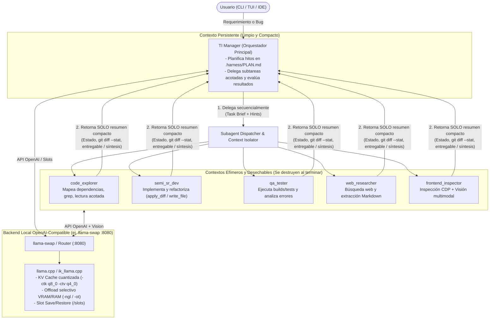
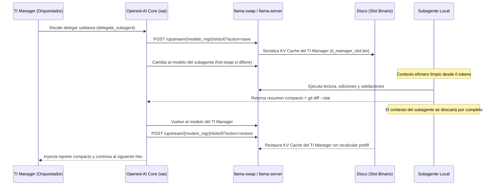
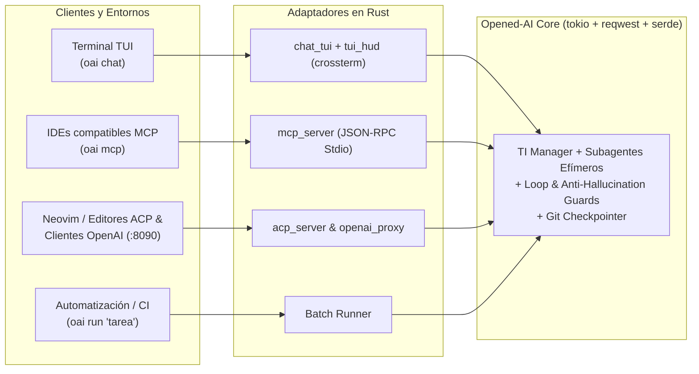

# ⚡ Opened-AI (`oai`): Agentic Harness for Local MoE & OpenAI-Compatible LLMs

**Opened-AI** (`oai`) es un motor de orquestación agéntica minimalista y de alto rendimiento escrito en **Rust**, diseñado para operar de forma confiable sobre **LLMs locales** (especialmente modelos MoE y densos cuantizados con `ik_llama.cpp` / `llama.cpp` + `llama-swap`, o cualquier endpoint compatible con la API de OpenAI) bajo presupuestos de contexto acotados (**16K–64K tokens**).

A diferencia de los harnesses pensados para APIs en la nube de 128K–200K tokens, **Opened-AI** implementa una arquitectura **Jerárquica Secuencial de Contexto Desechable (*Sequential Disposable Subagent Architecture*)**:
- Un agente principal (**TI Manager**) planifica y coordina manteniendo su contexto compacto.
- Los **subagentes especializados** ejecutan exploración, edición, pruebas, investigación web (RAG) e inspección visual en ventanas de contexto **efímeras y desechables**, devolviendo únicamente un resumen estructurado con los cambios y resultados.

---

## Instalación rápida

### Linux / macOS
```bash
git clone https://github.com/TU_USUARIO/opened-ai.git
cd opened-ai
chmod +x install.sh
./install.sh --server <SERVER_HOST_OR_IP>
```

### Windows (PowerShell)
```powershell
git clone https://github.com/TU_USUARIO/opened-ai.git
cd opened-ai
.\install.ps1 -ServerHost <SERVER_HOST_OR_IP>
```

### Compilación manual desde fuente
```bash
cargo build --release
# El binario queda en target/release/oai (o target/release/oai.exe en Windows)
```

---

## 1. ¿Por qué Opened-AI para LLMs Locales?

Al ejecutar modelos locales en GPUs de consumo (8–16 GB VRAM con offloading parcial de expertos MoE a RAM), los harnesses tradicionales suelen degradar la latencia y la precisión:

| Enfoque tradicional | Limitación en LLMs locales | Solución en **Opened-AI** |
| :--- | :--- | :--- |
| **System prompts masivos (6K–11K tokens)** | Consumen gran parte de la ventana antes del primer turno y rompen el *Prefix Caching*. | **System Prompt compacto** y esquemas de herramientas planos. |
| **Hilos monolíticos acumulativos** | Acumulan salidas completas de consola, archivos y `<think>`, saturando el contexto y provocando alucinaciones. | **Contextos desechables por subtarea:** el ruido muere con el subagente; el TI Manager solo recibe el resumen. |
| **Ejecución paralela en un solo nodo** | Multiplica el consumo de KV Cache y VRAM al abrir varios slots simultáneos. | **Ejecución secuencial (`--parallel 1`)** con soporte de `save/restore` de slots (`/slots`). |

---

## 2. Arquitectura: TI Manager + Subagentes Efímeros



### 2.1. Metodología de Slot-Swap y Contexto Efímero (Disco ↔ VRAM)

Para ejecutar múltiples modelos especializados en una sola GPU local sin multiplicar la VRAM ni perder el hilo del orquestador:



1. **Congelación a disco (`save_slot`):** antes de delegar, `oai` guarda el estado binario de la KV Cache del `TI Manager` en disco.
2. **Swap de modelo y contexto desde cero:** `llama-swap` descarga el modelo del orquestador y carga el modelo del subagente (si usa otro perfil); el subagente arranca con su ventana efímera limpia, sin arrastrar el historial del manager.
3. **Descarte total del ruido:** al terminar (o alcanzar `max_iterations` con `[SÍNTESIS POST-LÍMITE]`), toda la conversación intermedia del subagente se destruye y **no** contamina la ventana del `TI Manager`.
4. **Restauración instantánea (`restore_slot`):** al regresar al modelo del orquestador, `oai` recarga el slot desde disco evitando re-evaluar el prefijo completo de conversación.

### 2.2. Capturas de la Sesión TUI (`oai chat`)

> Para mostrar tus capturas en GitHub, guarda tus PNG en [`docs/images/`](docs/images/README.md) con estos nombres:

#### Vista general del TUI y seguimiento de plan


#### Delegación de la capa de orquesta hacia subagentes locales


---

## 3. Roles de Agentes

### 3.1. Agente Principal: `ti_manager`
* **Responsabilidad:** dividir el objetivo en hitos verificables dentro de `.harness/PLAN.md`, delegar tareas pequeñas y concretas a los subagentes, y validar avances reales antes de pasar al siguiente hito.
* **Control de avance:** incluye chequeos anti-divagación cuando encadena turnos sin progreso concreto y mantiene la sesión persistente en `.harness/manager_session.json` (reanudable con `/resume`).

### 3.2. Subagentes Especializados (Contexto Desechable)

| Subagente | Rol | Herramientas principales | Resultado retornado |
| :--- | :--- | :--- | :--- |
| **`code_explorer`** | Explorador de código | `find_files`, `list_files`, `grep_search`, `read_file` | Rutas, líneas clave y contratos encontrados. |
| **`semi_sr_dev`** | Implementador / Refactor | `read_file`, `apply_diff`, `write_file`, `shell_exec`, `find_files`, `grep_search` | Cambios aplicados, validación y `git diff --stat`. |
| **`qa_tester`** | QA y Verificador | `shell_exec`, `read_file`, `bg_process`, `grep_search` | `PASS/FAIL`, causa raíz y salida compacta. |
| **`web_researcher`** | Investigador Web RAG | `web_rag`, `read_file` | Síntesis técnica y fragmentos de documentación. |
| **`frontend_inspector`** | Auditor Visual UI | `vision_inspect`, `bg_process`, `read_file` | Diagnóstico visual por viewport y errores de consola. |
| **`security_auditor`** | Auditoría Técnica | `read_file`, `shell_exec`, `grep_search` | Hallazgos de seguridad, cuellos de botella y parches. |

---

## 4. Capacidades Nucleares y Guardas de Estabilidad

1. **Edición quirúrgica (`apply_diff` + `write_file`) y normalización de rutas:**
   * Soporta bloques `SEARCH/REPLACE` con *fuzzy matching* tolerante a indentación y diagnósticos estáticos inmediatos tras editar (`diagnostics.rs`).
   * Normaliza prefijos redundantes del workspace en rutas relativas (evitando bucles por rutas duplicadas).
2. **Guarda antialucinación multi-lenguaje (`EcosystemApiRule`):**
   * Detecta automáticamente errores de símbolos, variantes o imports inexistentes en compilación/runtime para **Rust**, **JS/TS/React**, **Python**, **Go**, **C#/.NET** y **Java**.
   * Exige consultar la definición real instalada en disco (`Cargo.lock`/`.cargo/registry`, `node_modules/**/*.d.ts`, `site-packages`, `go doc`, `.nuget`, `.m2`/`javap`) y bloquea ediciones repetidas a ciegas si el subagente reincide sin verificar.
3. **Cortacircuitos anti-bucles y anti-estancamiento:**
   * **`LoopGuard`:** detecta y corta llamadas repetidas con los mismos argumentos.
   * **Aviso de estancamiento:** redirige a subagentes escritores si acumulan demasiados pasos leyendo sin aplicar cambios.
   * **Síntesis post-límite:** si un subagente alcanza `max_iterations`, genera una síntesis estructurada de lo avanzado y pendiente para no devolver respuestas vacías al `ti_manager`.
   * **Saneamiento de `tool_calls`:** repara o descarta llamadas JSON truncadas antes de reenviar historial al backend, evitando errores `HTTP 500`.
4. **Terminal inteligente (`shell_exec`) y procesos en segundo plano (`bg_process`):**
   * Ejecución con timeout, truncamiento inteligente de logs largos y gestión de servidores de desarrollo en background con lectura de logs bajo demanda.
5. **Web RAG comprimido (`web_rag`) y Visión vía CDP (`vision_inspect`):**
   * Extracción de documentación web limpia en Markdown y auditoría visual de interfaces locales mediante Chrome DevTools Protocol (CDP) + modelos con soporte multimodal (`mmproj`).
6. **Skills bajo demanda (`skills/<nombre>/SKILL.md`):**
   * Carga perezosa (*lazy loading*) de instrucciones especializadas solo cuando la tarea las requiere.
7. **Optimización para `ik_llama.cpp` / `llama-swap`:**
   * Soporte de `/slots` (`save`/`restore`) para preservar el prefijo del `ti_manager` entre invocaciones de subagentes, poda automática de `<think>` de turnos pasados y compatibilidad con splits selectivos VRAM/RAM (`-ngl` + `-ot`) y KV Cache cuantizada (`-ctk q8_0 -ctv q4_0`).

---

## 5. Arquitectura en Rust y Modos de Ejecución ("1 Core, 4 Protocolos")

Construido en **Rust (Edición 2021)** para producir un binario nativo único (`oai` / `oai.exe`) con bajo consumo de RAM (~5–15 MB) y arranque instantáneo:



### Modos disponibles del binario `oai`
1. **`oai chat`**: TUI interactiva con HUD de estado, panel de plan (`.harness/PLAN.md`), árbol de iteraciones, `<think>` colapsable (`Ctrl+O` / `/think`), selector `/model` al vuelo, `/resume` y `/clear`.
2. **`oai mcp`**: Servidor MCP por `stdio` para IDEs compatibles.
3. **`oai acp` / `oai serve --host 0.0.0.0 --port 8090`**: Integración ACP (`stdio`) o Proxy OpenAI con streaming SSE.
4. **`oai run "<instrucción>"`**: Ejecución autónoma *one-shot* desde terminal o scripts.

---

## 6. Estructura del Proyecto (`opened-ai`)

```text
opened-ai/
├── README.md                  # Documentación y arquitectura de Opened-AI
├── Cargo.toml                 # Manifiesto Rust (paquete `opened-ai`, binario `oai`)
├── install.sh / install.ps1   # Compilación e instalación en Linux / Windows
├── config/
│   ├── config.yaml            # Endpoint OpenAI-compatible, presupuestos de contexto y agentes
│   └── llama-swap-vision.yaml # Plantilla de referencia para llama-swap con visión y slots
├── src/
│   ├── main.rs                # Entrypoint CLI: chat, mcp, acp, serve, run
│   ├── config.rs              # Carga de config.yaml + overrides (`OPENED_AI_HOST`, etc.)
│   ├── skills.rs              # Motor lazy-loaded de Skills (`SKILL.md`)
│   ├── interfaces/            # chat_tui.rs, tui_hud.rs, mcp_server.rs, acp_server.rs, openai_proxy.rs
│   ├── core/                  # orchestrator.rs, subagent.rs, client.rs, loop_guard.rs, checkpoint.rs
│   └── tools/                 # execute_local_tool, diagnostics.rs, bg_process.rs, web_rag.rs, vision_cdp.rs
└── skills/                    # Biblioteca modular de Skills bajo demanda
```

---

## 7. Configuración Rápida (`config/config.yaml`)

Ajusta `server.base_url` al endpoint de tu servidor local (`llama-swap`, `llama-server`, Ollama o cualquier API compatible con OpenAI):

```yaml
server:
  base_url: "http://127.0.0.1:8080/v1"
  timeout_secs: 600
  use_slots_cache: true

context_budget:
  max_context_tokens: 32768
  soft_limit_tokens: 24576
```

También puedes sobrescribir el host sin editar archivos mediante variables de entorno (por ejemplo `OPENED_AI_HOST=<IP_O_HOST>`).
