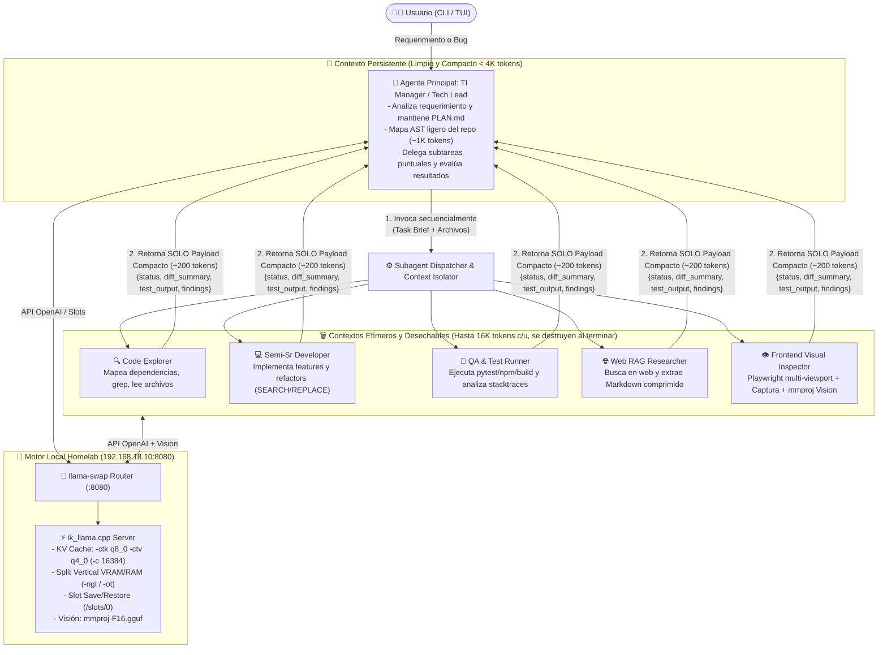
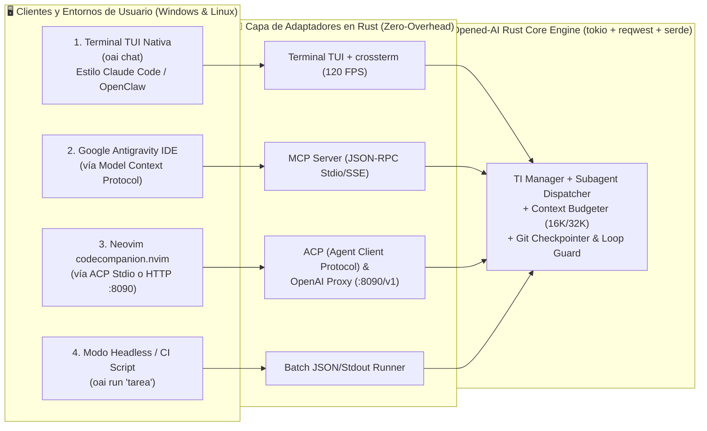

# ⚡ Opened-AI (`oai`): OpenAI-Compatible Agentic Control for Local MoE LLMs

**Opened-AI** (`oai`) es un motor de orquestación agéntica minimalista y de alto rendimiento en Rust — una alternativa abierta bajo tu control total que combina la interfaz y compatibilidad estilo OpenAI con **LLMs MoE locales** (~30B–35B parámetros totales con ~3B–4B activos en VRAM y capas particionadas en RAM mediante **`ik_llama.cpp`** y **`llama-swap`**), operando de forma óptima bajo presupuestos de **16K–32K tokens de contexto (KV Cache)**.

A diferencia de los frameworks comerciales o de nube (pensados para ventanas de 128K–200K tokens), **Opened-AI** implementa una arquitectura **Jerárquica Secuencial de Contexto Desechable (*Sequential Disposable Subagent Architecture*)**: un agente principal (**TI Manager**) planifica y coordina manteniendo su contexto ultraligero, mientras delega la exploración, codificación, ejecución de tests, investigación web (RAG) y auditoría visual de interfaces frontend a **subagentes especializados cuyos contextos se destruyen al finalizar su subtarea**.

### Instalación rápida en cliente Linux / Windows (LAN)

```bash
# Linux / macOS
git clone https://github.com/TU_USUARIO/opened-ai.git
cd opened-ai && chmod +x install.sh
./install.sh --server 192.168.18.10
```

```powershell
# Windows
git clone https://github.com/TU_USUARIO/opened-ai.git
cd opened-ai
.\install.ps1 -ServerHost 192.168.18.10
```

---

## 1. Diagnóstico Técnico: ¿Por qué crear nuestro propio Harness?

Al operar un homelab local con una **RTX 3060 Ti (8 GB VRAM con Resizable BAR)** + **32 GB RAM DDR4** y modelos como **`Qwen 3.8 35B-A3B (IQ3_M / APEX Uncensored)`**, **`Qwen 3.6 35B-A3B`** y **`Gemma 4 26B-A4B`** a ~14–18 tokens/s, las herramientas existentes presentan cuellos de botella estructurales:

| Herramienta Probada | Problema Principal en Contextos Locales de 16K | Impacto en `ik_llama.cpp` |
| :--- | :--- | :--- |
| **RooCode / Cline / Continue (Agent)** | **Impuesto de System Prompt masivo (6,000 a 11,000 tokens):** Inyectan decenas de esquemas JSON/XML de herramientas, reglas verbosas y estado dinámico del IDE en cada turno. | Consume el **50–65% de los 16K tokens antes de empezar** e invalida el *Prefix Caching* en cada turno, forzando re-evaluaciones lentas de prefill. |
| **OpenCode / Hermes Agent** | **Monolitos de contexto acumulativo:** Cargan decenas de *skills* en memoria y acumulan salidas crudas de consola, trazas de error y cadenas `<think>` en un único hilo de conversación. | A partir del turno 5–8, la ventana de 16K se satura (`context shift` agresivo), diluyendo la atención del modelo y degradando su precisión lógica. |
| **Aider CLI** | **Excelente edición (`SEARCH/REPLACE`) y mapa AST (`Tree-Sitter`), pero sin autonomía multi-agente:** Carece de subagentes con contexto efímero, RAG web bajo demanda, carga dinámica de *skills* y visión multimodal para inspección de UI/Frontend. | Muy rápido y respetuoso con la KV Cache (~2.2K tokens base), pero limitado a edición asistida en un solo bucle sin delegación ni validación visual. |

### La Filosofía de Opened-AI (Control Total sobre LLMs Locales)
Combinamos la **cirugía de bajo consumo de tokens de Aider** (bloques `SEARCH/REPLACE` + mapa AST de ~1K tokens) con el patrón moderno de **Subagentes con Ventana de Contexto Desechable** (*Disposable Context Windows*, inspirado en arquitecturas minimalistas como *Pi Agent* y *Smolagents*):

1. **System Prompt Base < 800 tokens:** Cero relleno. Herramientas definidas con esquemas ultra-compactos.
2. **Un Solo Slot de Inferencia (`--parallel 1`), Ejecución Secuencial Inteligente:** Nunca lanzamos subagentes en paralelo para no multiplicar el consumo de VRAM de la KV Cache. Los subagentes se ejecutan **en serie**, reutilizando el motor a máxima velocidad.
3. **Aislamiento Total del Ruido (*Zero Context Pollution*):** Cuando un subagente lee 4 archivos, prueba 3 comandos de terminal, corrige un bug de sintaxis y gasta 9,000 tokens en el proceso, **esos 9,000 tokens mueren con el subagente**. El **TI Manager** solo recibe un resumen estructurado de ~200 tokens con el `git diff --stat` y el resultado de las pruebas.

---

## 2. Arquitectura del Sistema: Patrón "TI Manager + Subagentes Efímeros"



---

## 3. Flujo de Trabajo y Roles de los Agentes

### 3.1. Agente Principal: `TI Manager` (Orquestador Persistente)
* **Misión:** Entender la arquitectura global, dividir el trabajo en pasos atómicos en `.harness/PLAN.md`, invocar al subagente idóneo para cada paso y validar que el entregable cumpla el estándar antes de avanzar.
* **Regla de Oro:** El `TI Manager` **tiene prohibido** volcar archivos completos en su propio contexto o pegarse en bucles de depuración de consola. Si necesita saber cómo funciona un módulo, envía al `Code Explorer`; si necesita programar o refactorizar, envía al `Semi-Sr Developer`.

### 3.2. Subagentes Especializados (Contexto Desechable)

| Subagente | Rol Técnico | Herramientas Permitidas | Qué recibe de entrada | Qué devuelve al `TI Manager` (y muere) |
| :--- | :--- | :--- | :--- | :--- |
| **`explorer`** *(Code Explorer)* | Investigador de código | `grep_search`, `list_files`, `read_file_range`, `ast_outline` | Pregunta puntual (ej. *"¿Dónde y cómo se valida el JWT?"*) | Mapa exacto de archivos, líneas clave y resumen de contratos (~250 tokens). |
| **`developer`** *(Semi-Sr / Sr Dev)* | Implementador y Refactorizador | `read_file_range`, `apply_diff` (`SEARCH/REPLACE`), `write_file`, `linter_check` | Especificación técnica + rutas de archivos objetivo + fragmentos relevantes | Estado de los parches aplicados, `git diff --stat` y resumen de cambios (~200 tokens). |
| **`qa_tester`** *(QA & Debugger)* | Validador de Pruebas y Consola | `shell_exec`, `read_file_range` | Comando de prueba a validar + criterios de éxito | `PASS/FAIL`, causa raíz exacta si falló (línea y archivo) sin basura de logs (~200 tokens). |
| **`web_researcher`** *(Web RAG)* | Investigador de Documentación | `web_search`, `fetch_clean_md` | Consulta técnica o error de librería externa | Síntesis técnica accionable + snippet de código validado (~300 tokens). |
| **`frontend_inspector`** *(UI & Vision QA)* | Auditor Visual y Responsive | `capture_viewport` (Playwright), `capture_screen`, `vision_analyze`, `browser_console` | URL local (ej. `http://localhost:5173`) o ventana + criterios visuales | Reporte de bugs visuales, desbordamientos CSS, fallos mobile/desktop y errores JS de consola. |
| **`security_auditor`** *(Uncensored Spec)* | Auditor Técnico sin Filtros | `read_file_range`, `shell_exec`, `web_search` | Script, configuración de red o binario a auditar (usa `qwen38-uncensored`) | Reporte directo de vulnerabilidades, cuellos de botella o parches. |

---

## 4. Las 6 Capacidades Nucleares del Harness

### 4.1. Ejecución CLI / Shell con Truncamiento Inteligente (`shell_exec`)
Un comando de compilación o test puede escupir 500 líneas de salida (4,000+ tokens). En **Llama-Harness**, el ejecutor de terminal:
* Ejecuta comandos en PowerShell / Bash con control de *timeout* y captura de `stdout`, `stderr` y `exit_code`.
* **Smart Log Compactor:** Si la salida supera las 60 líneas, conserva automáticamente la cabecera, filtra líneas repetitivas de progreso y extrae el bloque final donde reside el `Traceback` o `Error`, ahorrando hasta un **85% de tokens**.

### 4.2. Edición Quirúrgica de Código (`apply_diff` + Verificación AST)
* Utiliza el formato de bloques `<<<<<<< SEARCH ... ======= ... >>>>>>> REPLACE`, el formato más eficiente en tokens y más fiable para la familia **Qwen 3.6 / 3.8** cuantizada en `IQ3_M`.
* Incluye **Fuzzy Matching tolerante a indentación** y validación sintáctica inmediata (`ast.parse` en Python, `tsc`/`eslint` en JS/TS) antes de dar por bueno el cambio del subagente. Si el diff tiene un error de sintaxis, el propio subagente recibe el error al instante y lo corrige dentro de su contexto desechable antes de responder al `TI Manager`.

### 4.3. Web RAG Bajo Demanda Ultra-Comprimido (`web_rag`)
* Cuando el modelo necesita consultar documentación reciente o resolver un bug oscuro:
  1. Realiza búsqueda web ligera (DuckDuckGo HTML/Lite o API configurada).
  2. Descarga las páginas relevantes y las pasa por un **pipeline de limpieza DOM $\rightarrow$ Markdown** (`trafilatura` / `readability` + filtro de bloques de código).
  3. Aplica un ranking por fragmentos (*chunking* + similitud léxica/BM25 contra la consulta) para inyectar **únicamente los 800–1,200 tokens más útiles** en el subagente `web_researcher`.

### 4.4. Sistema de `Skills` y `Agents` con Carga Perezosa (*Lazy Loading*)
* Las *skills* se definen como archivos Markdown modulares en `.harness/skills/<skill_name>/SKILL.md` y los agentes en `.harness/agents/<agent_name>.yaml`.
* **Cero sobrecarga en el System Prompt:** El `TI Manager` solo ve un índice compacto de nombres y descripciones de 1 línea (~15 tokens por skill). Cuando asigna una tarea a un subagente, le adjunta dinámicamente solo la *skill* necesaria (por ejemplo, `skill: fastapi-clean-arch` o `skill: tailwind-responsive`).

### 4.5. Visión Multimodal Nativa e Inspección Frontend (`vision_inspect`)
Aprovechando que tu homelab cuenta con los proyectores multimodales **`mmproj-F16.gguf`** y **`mmproj-Qwen3.6...f16.gguf`**:
* **Captura de Escritorio / Ventana Activa:** Captura rápida en memoria (`mss` / `Pillow`), redimensionada inteligentemente (ej. máx `1280px` de lado mayor con compresión WebP/JPEG optimizada) para no saturar los tokens visuales del proyector `mmproj`.
* **Auditoría Automatizada de Proyectos Frontend (Playwright):**
  1. Levanta o conecta con el servidor de desarrollo local (`localhost:3000`, `localhost:5173`, etc.).
  2. Renderiza la página en **3 viewports estándar**:
     * **Desktop:** `1440x900`
     * **Tablet:** `768x1024`
     * **Mobile:** `375x812`
  3. Captura simultáneamente: **Screenshots**, **errores de consola JS (`pageerror` / `console.error`)**, **peticiones de red fallidas (`4xx/5xx`)** y **métricas DOM de desbordamiento horizontal** (`document.documentElement.scrollWidth > window.innerWidth` para detectar roturas de *responsiveness* con precisión matemática además de visual).
  4. Envía las capturas + telemetría DOM al modelo con visión para que identifique elementos solapados, textos cortados, falta de contraste o botones fuera de pantalla, devolviendo al `Semi-Sr Developer` las correcciones CSS/HTML exactas.

### 4.6. Optimización Extrema de KV Cache, Contexto de 32K y Slots en `ik_llama.cpp`

#### A. Análisis Empírico: ¿Cuánto baja la velocidad al subir a 32K tokens y pasar 2 capas a RAM?
A partir de las métricas reales extraídas de `main.log` en tu homelab (`arch = qwen35moe`, 40 bloques repetitivos + 1 capa de salida), descubrimos una ventaja arquitectónica decisiva de tus modelos **Qwen 3.6 y Qwen 3.8 35B-A3B**:
* **Atención Híbrida (Gated DeltaNet / SSM + Full Attention cada 4 capas):**
  * De las 40 capas del modelo, **30 capas son recurrentes (SSM)** (su estado de memoria es **fijo** y no crece con el contexto) y **solo 10 capas (capas 3, 7, 11, 15, 19, 23, 27, 31, 35, 39) usan KV Cache de atención completa** con `head_count_kv = 2`.
  * Con `-ctk q8_0 -ctv q4_0`, **8,192 tokens ocupan apenas `65.00 MiB` de KV Cache total** (`42.5 MiB` en K y `22.5 MiB` en V).
  * Por tanto:
    * **16,384 tokens (16K)** ocupan solo **`~130 MiB`** de KV Cache total.
    * **32,768 tokens (32K)** ocupan solo **`~260 MiB`** de KV Cache total (~130 MiB adicionales frente a 16K).
* **Impacto en VRAM vs. Peso por Capa:**
  * Cada capa completa (`blk.N`) pesa entre **`319.4 MiB` y `355.4 MiB`**.
  * Esto significa que **bajar 1 sola capa de VRAM a RAM libera ~320–355 MiB**, lo cual es **más del doble** de lo que necesitas para subir el contexto de 16K a 32K (~130 MiB). De hecho, en `Qwen 3.8 Distill IQ3_M` (que a `-ngl 18` usa `7,640 MiB / 8,192 MiB`), con `-ngl 16` ya tienes ~1,100 MiB libres y **puedes activar `-c 32768` sin bajar ni una capa más**.
* **Impacto Exacto en Velocidad (`tokens/s`) si pasas 2 capas más a RAM (`-ngl 18` $\rightarrow$ `-ngl 16`):**
  * En tu RTX 3060 Ti (448 GB/s), evaluar los 8 expertos activos de 1 capa toma **~0.08 ms**.
  * En tu RAM DDR4 Dual-Channel @ 3200 MHz con el i7-9700 AVX2 (~38 GB/s reales), evaluar 1 capa toma **~1.95 ms**.
  * Pasar 2 capas de VRAM a RAM añade **`+3.74 ms` por token**:
    * **En `Qwen 3.6 IQ3_M` (`13.94 t/s` = `71.7 ms/tok`):** Pasa a `75.4 ms/tok` $\rightarrow$ **`~13.25 tokens/s`** (una caída mínima de **`-0.69 t/s` o `-4.9%`**).
    * **En `Qwen 3.8 Distill IQ3_M` (`14.44 t/s` = `69.2 ms/tok`):** Pasa a `72.9 ms/tok` $\rightarrow$ **`~13.70 tokens/s`** (caída de **`-0.74 t/s`**).
* **El Secreto del Split Vertical Selectivo (`-ot`) descubierto en `main.log`:**
  * En `main.log` (línea 180) se observa que, de los `13,919 MiB` del modelo, los 256 expertos FFN pesan **`13,362.88 MiB`**, mientras que **TODOS los tensores de Atención, SSM y Shared Experts de las 40 capas juntos pesan apenas `556.81 MiB`** (`2.09 MiB` en capas SSM y `6.50 MiB` en capas de atención completa).
  * Si usamos `-ngl 99` combinado con `-ot` para enviar a la CPU **únicamente las matrices de expertos FFN (`ffn_.*_exps`) de las capas 18 a 39**:
    ```powershell
    C:\ik_llama.cpp\llama-server.exe `
      -m "B:\develop\LLAMA.CPP_IA_LOCAL\modelos\Qwen3.8-35B-A3B-IQ3_M.gguf" `
      -ngl 99 `
      -ot "blk\.(1[8-9]|[2-3][0-9])\.ffn_.*_exps\.weight=CPU" `
      -c 32768 -fa on -ctk q8_0 -ctv q4_0 `
      --slot-save-path "B:\develop\LLAMA.CPP_IA_LOCAL\slots"
    ```
    **Resultado:** ¡El **100% de las 40 capas de Atención y el 100% del KV Cache de 32K tokens permanecen en la GPU RTX 3060 Ti** (gastando solo ~160 MiB extra de VRAM), evitando que la CPU tenga que calcular atención cuando el contexto crece!

#### B. Congelación de KV Cache (`/slots`) y Presupuesto Dinámico de `<think>`
1. **Congelación y Restauración de KV Cache (`/slots/0?action=save|restore`):**
   * Antes de lanzar un subagente, el Harness puede guardar el estado binario de la KV Cache del `TI Manager` (`POST /slots/0?action=save` $\rightarrow$ `ti_manager.bin`) y restaurarlo al terminar el subagente (`POST /slots/0?action=restore`), eliminando el tiempo de re-procesamiento (*prefill*) del agente principal.
2. **Presupuesto Dinámico de `<think>` por Rol:**
   * El `TI Manager` y el `Semi-Sr Developer` operan con `--reasoning-budget 512`, mientras que subagentes mecánicos (`explorer`, `web_researcher`) pueden limitar o desactivar el bloque `<think>` por petición para responder el doble de rápido.

---

## 5. Arquitectura Multiplataforma en Rust 🦀 y Multi-Interfaz ("1 Core, 4 Protocolos")

Para que **Opened-AI (`oai`)** tenga un consumo mínimo de memoria (**~4–8 MB de RAM**, dejando los 32 GB DDR4 libres para los expertos MoE), arranque en **< 3 milisegundos** y produzca **un único binario nativo sin dependencias externas** tanto en **Windows 11 Bare-Metal (`oai.exe`)** como en **Linux (`oai`)**, está construido íntegramente en **Rust (Edición 2021)** bajo una **Arquitectura Hexagonal** que expone **4 interfaces de comunicación**:



### Stack Tecnológico de Alto Rendimiento en Rust (`Cargo.toml`)
* **Runtime Asíncrono:** `tokio` (multihilo ligero para I/O no bloqueante, subprocesos y sockets).
* **Cliente HTTP/SSE y Control de Slots:** `reqwest` con `rustls` (TLS nativo puro en Rust, cero dependencia de OpenSSL en Windows o Linux).
* **Serialización y Reparación de Tool Calls:** `serde` + `serde_json` ultrarrápido con parser tolerante para bloques `<tool_call>` y `<think>`.
* **Terminal TUI Interactiva:** HUD fijo + viewport scrolleable + `crossterm` (compatible nativamente con Windows Terminal/PowerShell y Linux TTY).
* **Búsqueda Ultrarrápida en Repositorios:** `walkdir` + `regex` con filtros `subdir`/`glob` (`find_files` y `search_code`) compilado dentro de `oai`.
* **Visión Frontend sin Node.js/Playwright:** Control directo por **Chrome DevTools Protocol (CDP WebSocket)** mediante `tokio-tungstenite` o Chrome Headless.

### Los 4 Modos de Ejecución del Binario Único `oai` (`oai.exe` / `oai`):
1. **`oai chat` (TUI Interactiva con HUD fijo y `Ctrl+O`):**
   * Muestra en tiempo real el árbol de actividad de los subagentes, bloques `<think>` colapsados (`Ctrl+O`), cambio de modelo `/model` al vuelo, preguntas interactivas (`clarify`) y memoria persistente (`.harness/MEMORY.md`).
2. **`oai mcp` (Servidor MCP para Antigravity IDE):**
   * Binario instantáneo (<2 ms de arranque) que expone `oai_run_ti_manager`, `oai_delegate_subagent`, `oai_vision_inspect`, `oai_web_rag` y `oai_catalog`.
3. **`oai acp` y `oai serve --host 0.0.0.0 --port 8090` (Integración con Neovim `codecompanion.nvim` y clientes OpenAI):**
   * **Vía ACP (Agent Client Protocol):** `oai acp` por `stdio`.
   * **Vía Proxy Agéntico OpenAI (`:8090/v1/chat/completions`):** Expone `oai-ti-manager` y los subagentes como modelos OpenAI estándar con streaming SSE.
4. **`oai run "<instrucción>"` (Ejecución Autónoma One-Shot / Scripting):**
   * Lanza tareas desde scripts o pipelines de terminal y devuelve el resultado final.

---

## 6. Comparativa con Harnesses de Referencia y Lógicas Avanzadas Incorporadas

Auditamos la arquitectura interna de **Claude Code**, **Antigravity CLI**, **OpenClaw**, **Pi Coding Agent (`pi-mono`)** y **Aider** para validar que no falte ninguna herramienta ni lógica crítica de nivel empresarial:

| Capacidad / Lógica Compleja | Referencia en la Industria | Cómo lo implementa `Opened-AI` en tu Homelab |
| :--- | :--- | :--- |
| **1. Diagnósticos Estáticos Post-Edición (`diagnostics.rs`)** | *Claude Code / Antigravity* | Tras cada `apply_diff` del subagente `developer`, se ejecuta automáticamente el verificador rápido del lenguaje (`ruff`/`pyright`, `tsc --noEmit`, `gcc -fsyntax-only`, `javac`, `cargo check`) e inyecta los errores en el mismo turno antes de dar por cerrada la subtarea. |
| **2. Git Checkpointing & Rollback Atómico (`checkpoint.rs`)** | *Claude Code / Aider (`/undo`)* | Antes de que un subagente modifique archivos, el Harness crea un *snapshot* silencioso (`git stash create` / referencia temporal). Si el subagente falla o el `TI Manager` rechaza el cambio, se restaura el estado exacto en milisegundos. |
| **3. Gestor de Procesos en Background (`bg_process.rs`)** | *Antigravity (`manage_task`) / OpenClaw* | Herramienta dedicada para iniciar servidores de desarrollo (`npm run dev`, `uvicorn`, `cargo run`), esperar a que el puerto responda, leer sus logs sin bloquear la consola y detenerlos al finalizar la prueba. |
| **4. Cortacircuitos Anti-Bucles (`Loop & Entropy Guard`)** | *Crítico en LLMs locales 3-bit* | Detecta si un subagente repite la misma llamada a herramienta con los mismos argumentos o falla 2 veces seguidas en un bloque `SEARCH/REPLACE`, inyectando una pista correctiva o abortando temprano para no quemar tiempo de GPU. |
| **5. Parser Tolerante de `<tool_call>` Sin Bloqueos GBNF** | *Lección de tu `llama.log` + Pi Agent* | En `llama.log` detectamos que las gramáticas GBNF complejas provocan *resampling loops* en `ik_llama.cpp`. Usamos esquemas JSON planos (máx. 3–4 argumentos simples) combinados con un reparador sintáctico tolerante en Rust. |
| **6. Mapa Estructural de Símbolos (`repo_map.rs`)** | *Aider (Tree-Sitter / Regex AST)* | Genera un índice ultra-compacto (~800 tokens) con las firmas de clases, structs y funciones del repositorio en milisegundos usando el motor de `ignore`/`ripgrep`. |
| **7. Compuerta de Permisos (`Permission Gate`)** | *Claude Code / OpenClaw* | Clasifica cada acción en `SAFE_READ` (auto), `WORKSPACE_WRITE` (auto con checkpoint Git) y `SYSTEM_DANGEROUS` (requiere confirmación del usuario si intenta borrar fuera del repo o hacer `git push`). |
| **8. Compresión Semántica de Sesión (`Session Compactor`)** | *Claude Code (`/compact`)* | Poda automáticamente los bloques `<think>` de turnos pasados y compacta el historial antiguo del `TI Manager` en `.harness/PLAN.md` cuando supera el umbral configurado. |

---

## 7. Estructura del Proyecto en Rust (`opened-ai`)

```text
opened-ai/
├── README.md                  # Arquitectura, diseño y guía del proyecto
├── MEMORY.md                  # Memoria persistente del homelab, hardware, modelos y ADRs
├── Cargo.toml                 # Manifiesto de Rust (paquete `opened-ai`, binario `oai`)
├── install.sh / install.ps1   # Auto-compilado e instalación para clientes Linux / Windows
├── config/
│   ├── config.yaml            # Endpoint (127.0.0.1:8080/v1), presupuesto 32K y definición de agentes
│   └── llama-swap-vision.yaml # Plantilla con split vertical (-ot), 32K, mmproj y slots
├── src/
│   ├── main.rs                # Entrypoint CLI: `oai chat`, `oai mcp`, `oai acp`, `oai serve`, `oai run`
│   ├── config.rs              # Carga de config.yaml + overrides `OPENED_AI_HOST` / user config dir
│   ├── skills.rs              # Motor Lazy-Loaded de Skills + auto-triggers
│   ├── interfaces/            # Adaptadores: chat_tui.rs, tui_hud.rs, mcp_server.rs, acp_server.rs, openai_proxy.rs
│   ├── core/                  # Orquestador TI Manager, subagentes desechables, client, loop_guard, checkpoint
│   └── tools/                 # Herramientas (`project_memory`, `clarify`, `find_files`, `search_code`, `web_rag`, `vision_cdp`, etc.)
└── skills/                    # Biblioteca de 14 Skills cargadas bajo demanda (`SKILL.md`)
```

---

## 8. Hoja de Ruta de Implementación en Rust (Paso a Paso)

* **Paso 1: Preparación del Toolchain de Rust e Infraestructura `llama-swap` (32K + `-ot` + Slots)**
  * Instalar `rustup` + toolchain ligero en Windows (`x86_64-pc-windows-gnu` con LLVM-MinGW o `msvc`).
  * Actualizar `llama-swap.yaml` con soporte de 32K tokens, split vertical `-ot`, `--slot-save-path` y perfil de visión `--mmproj`.
* **Paso 2: Inicialización del Crate `opened-ai` (`oai`) y Motor Core (`src/core/`)**
  * Configurar `Cargo.toml` y programar `client.rs` (streaming SSE, poda de `<think>`, `/slots`), `orchestrator.rs` (`TI Manager`), `subagent.rs` (contexto desechable), `loop_guard.rs` y `checkpoint.rs`.
* **Paso 3: Herramientas Nucleares (`src/tools/`)**
  * Implementar herramientas (`find_files`, `search_code`, `project_memory`, `clarify`), `diagnostics.rs`, `shell_exec` (con truncamiento inteligente de logs) y `bg_process.rs`.
* **Paso 4: Los 4 Adaptadores de Interfaz (`src/interfaces/`)**
  * Construir `chat_tui.rs` + `tui_hud.rs` (`oai chat`), `mcp_server.rs` (`oai mcp` para Antigravity IDE), `acp_server.rs` y `openai_proxy.rs` (`oai acp` / `oai serve` para `codecompanion.nvim`).
* **Paso 5: Web RAG y Visión Multimodal vía CDP Directo (`web_rag.rs` y `vision_cdp.rs`)**
  * Buscador Web RAG con compresión Markdown y auditoría visual Frontend en 3 viewports hablando CDP WebSocket directo con Chrome/Edge/Brave + proyector `mmproj`.

